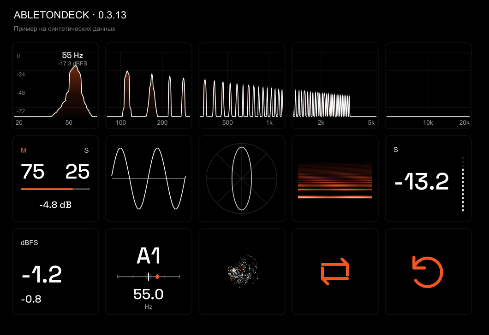

# AbletonDeck 0.3.15 beta

Free Stream Deck audio analysis and visuals for Ableton Live. MIT licensed; source included.



## Features

- Shared-scale FFT spectrum across five adjacent buttons (20 Hz–20 kHz), with row freeze.
- One-key spectrogram with eight seconds of scrolling spectral history.
- Triggered combined-channel oscilloscope, goniometer and Mid/Side energy balance.
- Momentary, short-term and experimental integrated LUFS; sample peak and reset.
- Monophonic frequency-to-note detection with a detune scale.
- Audio-reactive Flow particles that drift slowly in silence.
- Warm metronome icon: static on stop, pulsing to Live BPM during playback. This key is display-only.
- Optional transport, loop, track and scene controls through a Live Remote Script.

## Requirements and installation

Tested: Windows 10/11, Stream Deck 6.6+, Ableton Live 12 Suite with Max for Live. Other Live versions/editions are unverified. This installer does not support macOS or Stream Deck knobs.

Download AbletonDeck-Setup-0.3.15.exe from Releases. Close Stream Deck from its system tray. Run setup, select your existing Ableton User Library (find it in Live Settings > Library) and click Install / Update. No administrator rights, Node.js or Python are required by end users. The installer is currently unsigned.

1. Open Stream Deck and drag AbletonDeck actions onto your keys. Arrange Spectrum 1 / 5 through 5 / 5 consecutively from left to right.
2. Save your project and restart Live when convenient.
3. Put User Library > Presets > Audio Effects > Max Audio Effect > AbletonDeck > AbletonDeck Meter.amxd last on Main/Master. Keep yfc-meter.js beside it. Use one meter per project.
4. Optional Live controls: Settings > Link, Tempo & MIDI > Control Surface: AbletonDeck; Input/Output: None. Analysis and audio visuals do not require a Control Surface.

Setup preserves profiles and refuses to overwrite unmarked existing folders. It does not install Ableton, Max or Stream Deck. To remove files, close Stream Deck, run the same setup, select the same User Library and click Remove. Modified files and user settings are preserved. Remove the meter from your Live projects and deselect the Control Surface yourself.

## Measurement limits

The meter measures audio at its insertion point. Put it after the limiter, with the master fader at 0 dB for master-chain measurements. Sample peak is not true peak. Integrated LUFS (I*) is experimental; final export checks should use a verified meter. Pitch detection is monophonic, not chord recognition.

FFT uses a Hann window, stereo mean power and 480 logarithmic display points. At 48 kHz its window is 341 ms and bin spacing approximately 2.93 Hz. Visual scaling does not change audio.

Data is sent locally over loopback UDP 17940–17942; audio files are not recorded or uploaded. Multiple meters compete for the same destination and are unsupported.

## Build from source

Developers need Windows, Node.js/npm, Python 3 and the Windows .NET Framework C# compiler. From this repository directory:

```powershell
npm ci
Copy-Item node_modules com.personal.abletondeck.sdPlugin -Recurse -Force
python tools/build.py
node --test tests/*.test.cjs
powershell -NoProfile -ExecutionPolicy Bypass -File installer/build.ps1
```

EXE and SHA256SUMS.txt appear in dist/. The payload includes the Stream Deck plugin, M4L meter and Remote Script, excluding runtime logs and private settings. Installer tests cover installation, updates, removal, preservation of modified files, ownership checks and failure rollback.

.github/workflows/build-installer.yml builds and tests setup manually or on v* tags, then uploads a downloadable artifact. It does not publish a release automatically. CI execution has not yet been verified on GitHub.

For a standalone Stream Deck package:

```powershell
npx @elgato/cli pack com.personal.abletondeck.sdPlugin --output dist --force
```

Update package.json, tools/build.py and installer/Setup.cs (including assembly version metadata) together when changing release versions. Keep action UUIDs stable for existing profiles.

Optional preview tools require the npm package sharp. Numeric glyph outlines and PNG assets are already included. Font outline regeneration: install Python fonttools and run python tools/build-font.py.

## License

MIT: see LICENSE. Keep third-party and font notices in com.personal.abletondeck.sdPlugin/THIRD_PARTY.md and its licenses folder when redistributing.

Independent community project; not affiliated with Ableton or Elgato.
