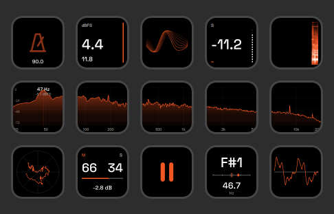

# Wander_scope 0.4.0 beta

Audio meters & visuals for Ableton Live and Stream Deck — by **Wanderwave**.

Formerly AbletonDeck. Existing action IDs, meter filenames and Control Surface names are retained so projects and Stream Deck profiles remain compatible.

Free Stream Deck audio analysis and visuals for Ableton Live. MIT licensed; source included.



## Features

Tap any Spectrum 1–5 key to expand the calibrated analyzer across all 15 keys (360 × 216 pixels). Tap any expanded key to return to the previous profile. Hold a spectrum key in the normal HUD to freeze/unfreeze the shared row. The expanded graph uses the same FFT, 480 logarithmic points, 20 Hz–20 kHz frequency range and fixed -84 to 0 dBFS scale; it does not control EQ parameters. Colours follow the source key across the whole graph. The expanded view renders once to native PNG tiles, skips unchanged tiles and drops frames when the outgoing queue is full. Smooth updates it at up to 20 frames/s; Economy at 10. Accept the bundled Spectrum profile on first opening.

Tap Spectrogram to open a detailed 360 Г— 216 image across the standard 15-key deck. Tap any tile to return to the previous profile. The expanded view follows the source key's palette, uses a shared 18-second history and updates at 8 frames/s. It preserves physical key gaps and shows bass below treble, with newest audio on the right. Accept the bundled Spectrogram profile when Stream Deck first offers it. Other device layouts are not supported by this view.

- Shared-scale FFT spectrum across five adjacent buttons (20 Hz–20 kHz), with row freeze.
- One-key spectrogram with eight seconds of scrolling spectral history.
- Triggered combined-channel oscilloscope, goniometer and Mid/Side energy balance.
- Momentary, short-term and experimental integrated LUFS; sample peak and reset.
- Monophonic frequency-to-note detection with a detune scale.
- Four audio-reactive visualizers: Particles, Ribbon, enlarged Field and Mesh. Select **Visualizer** in the action settings. Each key can use a different style and palette; all styles move slowly during silence. Existing keys keep Particles.
- Warm metronome icon: static on stop, pulsing to Live BPM during playback. This key is display-only.
- Play / Pause through a Live Remote Script. The action list contains only the 15 keys used by the HUD: Spectrum 1–5, LUFS, Sample Peak, Spectrogram, Mid/Side, Oscilloscope, Goniometer, Frequency → Note, Audio Reactive, Play / Pause and Metronome.

## Requirements and installation

The new VST3 audio bridge targets **Live 11 and 12: Lite, Intro, Standard and Suite**. It passes audio through unchanged and sends the existing meter/scope/pitch/FFT protocol locally. Max for Live is not required for VST3. The AMXD remains an alternative for Suite and Standard with a Max for Live license; use one source per project.

Stream Deck 6.6+; Windows 10/11 or macOS 13+. The standard HUD is 15 keys (5 x 3). Windows VST3 is x64. The macOS build targets Intel and Apple Silicon in one universal bundle. Automated tests do not replace testing each edition inside Ableton: actual Live testing to date is Windows Live 12 Suite. Live 11 and other editions need host verification before declaring full compatibility.

### Windows

Download **Wander_scope-Windows-0.4.0.zip** and extract it. Close Stream Deck from its tray. Run setup, select the existing Ableton User Library and click Install / Update. Open Stream Deck, accept and select Wander_scope HUD; all keys are already arranged. Save work and restart Live. Enable VST3 system folders and add **Wander_scope** last on Main/Master. If absent, set the VST3 custom folder to `%LOCALAPPDATA%/Programs/Common/VST3` and rescan. Setup installs the plugin, HUD, VST3, optional AMXD and Remote Script without administrator rights.

### macOS

Download **Wander_scope-macOS-0.4.0.zip**, extract and double-click the `.streamDeckPlugin` package. Accept Wander_scope HUD. Copy `VST3/Wander_scope.vst3` to `~/Library/Audio/Plug-Ins/VST3/`, enable VST3 system folders, restart Live and rescan. Add Wander_scope last on Main/Master. The build is ad-hoc signed, not Apple-notarized. The CI workflow builds and validates the universal bundle; source-only builds are not a tested Mac release.

### Controls and AMXD

For Play/Pause and BPM, install `AbletonDeck` into your User Library's `Remote Scripts` folder (automatic on Windows), restart Live and select Control Surface **AbletonDeck**, Input/Output **None**. This script targets the shared Live 11/12 API; tests use a mocked host and real UDP on isolated ports.

For the AMXD alternative, put the installed `AbletonDeck Meter.amxd` last on Main/Master and keep both JS files alongside it. Do not load VST3 and AMXD together. No Node.js or Python installation is needed by end users.

Windows setup preserves existing profiles and private settings and refuses to overwrite unmarked folders. Updates replace packaged program files. Removal preserves modified files and user settings. Setup does not install Ableton or Stream Deck.

## Measurement limits

The meter measures audio at its insertion point. Put it after the limiter, with the master fader at 0 dB for master-chain measurements. Sample peak is not true peak. Integrated LUFS (I*) is experimental; final export checks should use a verified meter. Pitch detection is monophonic, not chord recognition.

FFT uses a Hann window, stereo mean power and 480 logarithmic display points. At 48 kHz its window is 341 ms and bin spacing approximately 2.93 Hz. Visual scaling does not change audio.

Data is sent locally over loopback UDP 17940–17942; audio files are not recorded or uploaded. Multiple meters compete for the same destination and are unsupported.

## Build from source

### Colour and performance settings

Select a Wander_scope key in Stream Deck to choose **Global colour**, **Key colour**, and **Performance В· all keys**. Available palettes, in order: Original orange, Violet, Purple, Green, Blue, scarlet Red, and White. Each palette except Original orange has its own vertical gradient within its colour family; White uses only neutral greys. The former standalone Gradient selection migrates to Violet. Set **Key colour в†’ Same as global** for shared colours; existing fixed key colours are preserved. Hold an audio visual key to cycle its individual palette. The gradients are static and add no animation timer; spectrogram colours map intensity through the same family of hues.

**Smooth** refreshes the oscilloscope up to 40 times/s, spectrum and particle flow up to 20 times/s, and numeric/control keys up to 8 times/s. **Economy** uses 20, 10, and 4 times/s respectively, with fewer particle trails. Spectrogram history advances at 8 columns/s in both modes. Unchanged images are not sent again. Frames use the original Stream Deck's 72 Г— 72 pixel output size, retaining smooth vector geometry and white numbers. FFT window, calibration, pitch detection and LUFS calculations are unchanged by the performance setting; FFT and pitch processing run only when relevant keys are visible.

The Max for Live device uses a narrow 150 px panel: **Sending / to Stream Deck** with a pulsing dot while packets are emitted, including silence, or **Idle** if packets stop. Keep both `yfc-meter.js` and `yfc-panel.js` beside the AMXD.

Developers need Windows, Node.js/npm, Python 3 and the Windows .NET Framework C# compiler. From this repository directory:

```powershell
npm ci
Copy-Item node_modules com.personal.abletondeck.sdPlugin -Recurse -Force
python tools/build.py
node tools/test.cjs
python -m unittest discover -s tests -p "test_*.py"
# Build/validate native/CMakeLists.txt and stage its VST3 before setup.
powershell -NoProfile -ExecutionPolicy Bypass -File installer/build.ps1
python tools/build-release-zip.py dist
```

EXE, user ZIP and checksum files appear in dist/. Attach the Wander_scope-Windows ZIP to a GitHub Release as the end-user download; GitHub's automatic Source code archives are for developers. The payload includes the Stream Deck plugin, M4L meter and Remote Script, excluding runtime logs and private settings. Installer tests cover installation, updates, removal, preservation of modified files, ownership checks and failure rollback.

.github/workflows/build-installer.yml builds and tests both Windows and universal macOS packages manually or on v* tags. It runs the Steinberg VST3 validator, native measurement/processor tests, Stream Deck tests and Windows installer tests, then uploads ZIP artifacts. It does not publish a release automatically.

Native build: clone the pinned MIT Steinberg VST3 SDK (see native/CMakeLists.txt), configure with `cmake -S native -B native-build -DVST3_SDK_ROOT=SDK_PATH`, build Release, and run `ctest --test-dir native-build -C Release --output-on-failure`. On Mac set `-DCMAKE_OSX_ARCHITECTURES="arm64;x86_64"` and deployment target 13.0. Run `python tools/stage-vst.py native-build SDK_PATH` before packaging. Set `WANDER_SCOPE_DISABLE_TELEMETRY=1` during SDK validation to avoid broadcasting test audio to a running HUD; processor tests use isolated ports.

For a standalone Stream Deck package:

```powershell
npx @elgato/cli pack com.personal.abletondeck.sdPlugin --output dist --force
```

Update package.json, tools/build.py and installer/Setup.cs (including assembly version metadata) together when changing release versions. Keep action UUIDs stable for existing profiles.

Optional preview tools require the npm package sharp. Numeric glyph outlines and PNG assets are already included. Font outline regeneration: install Python fonttools and run python tools/build-font.py.

## License

MIT: see LICENSE. Keep third-party and font notices in com.personal.abletondeck.sdPlugin/THIRD_PARTY.md and its licenses folder when redistributing.

Independent community project; not affiliated with Ableton or Elgato.
